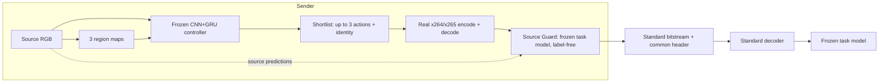

# VCAI (PRISM V34): tiền xử lý thích ứng trước H.264/H.265 cho thị giác máy

Phía gửi dùng bộ điều khiển CNN+GRU để chọn bộ lọc tần số theo vùng **trước x264/x265**. Bitstream là H.264/H.265 chuẩn; phía nhận chỉ cần decoder chuẩn rồi đưa RGB vào task model đã đóng băng. Codec, bộ lọc và task model không được huấn luyện lại.

> [!IMPORTANT]
> **Trạng thái kết quả.** Kết quả chính (AR, 1.024 video K400, bootstrap 5.000 lần) đã được kiểm chứng theo giao thức đóng băng trước. Các lần chạy held-out trên Kaggle (AR 128 clip, OD 256 ảnh, OT 1 chuỗi) là **pilot thăm dò**: `target_confirmed = false` trong [`test_summary.json`](results/v34_vcai_heldout_eval/ar_od_scaled/test_summary.json), cỡ mẫu nhỏ, OT chỉ có một chuỗi test. Đọc phần [Giới hạn](#7-giới-hạn-đã-biết) trước khi trích dẫn số liệu.

## 1. Pipeline


1. **Bản đồ vùng:** từ RGB nguồn, detector và chuyển động nhân quả tạo 3 bản đồ (object/history, context/motion, background).
2. **Controller CNN+GRU** (~8,7K tham số) nhận RGB, bản đồ vùng, codec/QP/task mask/budget, rồi xếp hạng **13 action lọc cố định** (gồm identity).
3. **Shortlist:** `[calibrated, forced, *ranked]` + identity, tối đa 3 action khác identity.
4. **Trial codec thật:** mã hóa và giải mã từng ứng viên bằng x264/x265.
5. **Source Guard:** chạy **chính task model đóng băng ở phía gửi** trên ảnh đã giải mã và đo độ lệch so với dự đoán trên nguồn (KL + khoảng cách đặc trưng cho AR, `detection_distance` cho OD, chi phí tracking so với track nguồn cho OT). **Không dùng nhãn** ([`tasks.py`](adaptive_vcm/v34/tasks.py#L94-L122), `source_only=True`). Chọn packet nhỏ nhất vượt ngưỡng; nếu không có thì dùng identity.

> [!WARNING]
> Source Guard yêu cầu phía gửi chạy **đúng task model** mà phía nhận dùng. Đây là thiết kế analysis-by-synthesis, không phải tiền xử lý độc lập với task. Điều này giải thích vì sao lợi ích **không chuyển được** sang R3D-18 (Mục 4A) và vì sao chi phí phía gửi cao (Mục 5).

Anchor: RGB giữ nguyên → cùng codec, QP, preset, GOP → cùng decoder → cùng task model. Rate = byte bitstream + common header / số pixel RGB; bản đồ vùng không được truyền.

<details>
<summary>Sơ đồ Mermaid</summary>



</details>

Chi tiết: [docs/PIPELINE.md](docs/PIPELINE.md).

## 2. Kết quả chính: AR trên 1.024 video Kinetics-400 (đã kiểm chứng)

BD-rate theo accuracy so với anchor; giá trị âm = giảm rate trên khoảng accuracy chung. Video Swin-T đóng băng (`Swin3D_T_Weights.KINETICS400_V1`).[^swin][^torchvision]

| Controller | H.264 BD-rate | H.264 CI | H.265 BD-rate | H.265 CI |
|---|---:|---|---:|---|
| **303401, primary chọn trước** | **−14.46%** | **97.5%: [−17.19; −11.68]%** | **−11.41%** | **97.5%: [−13.42; −9.43]%** |
| 303402 | −14.42% | 95%: [−16.83; −12.01]% | −11.62% | 95%: [−13.37; −9.88]% |
| 303403 | −14.67% | 95%: [−17.10; −12.12]% | −11.36% | 95%: [−13.14; −9.61]% |

Thiết lập: 1.024 ID thuộc K400 val chính thức (4 shard × 256), 16 frame stride 2, RGB 128×128, x264/x265 `medium`, QP 30/35/40/45/50, GOP 16, không B-frame; 112.640 dòng ghép cặp; bootstrap 5.000 lần theo video. CI chính dùng Bonferroni.

Cùng packet đó, **R3D-18 cho BD-rate +1.25% (H.264) / +2.11% (H.265)**, CI 95% chứa 0.[^r3d]

[REPORT.md](results/v34_r1/REPORT.md) · [independent_summary.json](results/v34_r1/independent_summary.json) · [merge-audit.json](results/v34_r1/merge-audit.json)

## 3. Ablation B0–B5 (replay trên ngân hàng 13 action đã đo)

Replay tất định trên các phép đo codec thật đã lưu, 4 QP [30, 35, 40, 45]. AR/OD dùng split `scaled/all`, OT dùng `MOT20-02/all`. Đây là **replay offline trên dữ liệu đã đo**, không phải một lần chạy held-out mới. Định dạng: Cubic / PCHIP.

| ID | Phương pháp | AR H.264 | AR H.265 | OD H.264 | OD H.265 | OT H.264 | OT H.265 |
|---|---|:---:|:---:|:---:|:---:|:---:|:---:|
| B0 | Identity (anchor) | 0 / 0 | 0 / 0 | 0 / 0 | 0 / 0 | 0 / 0 | 0 / 0 |
| B1 | Global Gaussian (`a_11`, `fixed`) | −7.06 / −7.19 | +5.41 / +0.63 | +3.45 / +3.30 | −0.91 / +3.21 | +5.00 / +6.94 | +1.29 / −2.96 |
| B2 | Region-aware cố định (`a_6`, mạnh) | −0.02 / +0.27 | +10.96 / +1.81 | +3.88 / +3.51 | −0.95 / +2.26 | +6.38 / +2.06 | −8.79 / −12.08 |
| B2 | Region-aware cố định (`a_5`, vừa) | −4.09 / −6.73 | +6.45 / +3.03 | +2.78 / +2.28 | −3.13 / +1.39 | −8.10 / −6.00 | +17.15 / −10.30 |
| B3 | CNN+GRU chọn trực tiếp (`forced`) | −4.36 / −4.95 | +1.13 / −1.87 | −4.40 / −3.67 | −2.11 / +0.17 | −11.74 / −3.00 | −8.79 / −12.08 |
| B4 | Random 3 ứng viên + Guard (TB 20 seed) | −20.82 / −24.74 | −15.20 / −17.12 | −25.52 / −26.15 | −16.14 / −17.35 | −6.64 / −7.19 | −9.12 / −13.27 |
| B5a | CNN+GRU + search, không Guard | −6.52 / −6.87 | +4.25 / +3.00 | +4.40 / +4.65 | −0.58 / +2.78 | +2.66 / +4.71 | +1.29 / −2.96 |
| B5b | Calibrated bound, không Guard | −4.99 / −6.59 | +0.83 / −1.95 | −3.13 / −3.57 | −2.69 / −0.04 | +4.99 / +6.94 | −4.39 / −4.44 |
| **Full** | **CNN+GRU shortlist + Guard** | **−26.05 / −30.88** | **−24.75 / −23.74** | **−33.26 / −31.17** | **−17.54 / −18.13** | **−19.76 / −22.07** | **−16.72 / −19.07** |

Đơn vị: %. Cách đọc thẳng thắn:

- **Guard đóng góp phần lớn lợi ích.** B4 (chọn ứng viên *ngẫu nhiên* + Guard) đã đạt −17% đến −26% trên AR/OD. Các biến thể không có Guard (B3, B5a, B5b) chỉ đạt khoảng ±7%.
- **Controller đóng góp phần còn lại.** Full tốt hơn B4 khoảng 1–6 điểm trên AR/OD và khoảng 6–15 điểm trên OT.
- Lọc cố định (B1, B2) không ổn định: dấu thay đổi theo codec và task.

## 4. Pilot held-out trên Kaggle GPU

Ba lần chạy độc lập trên Kaggle (Tesla T4), controller đóng băng, 4 QP [30, 35, 40, 45]. BD-quality = chênh lệch chất lượng trung bình trên khoảng rate chung (BD-Top-1 / BD-mAP / BD-HOTA, đơn vị điểm phần trăm), **không phải** trung bình chênh lệch theo QP.

### 4A. Action Recognition: K400 scaled, N = 128 clip

| Codec | Cấu hình | Cubic | PCHIP | BD-Top-1 |
|---|---|---:|---:|---:|
| H.264 | B1 `fixed` | −2.16% | −2.39% | +0.66 pp |
| H.264 | B3 `forced_303401` | +0.13% | −0.06% | −0.02 pp |
| H.264 | B5b `calibrated_303401` | +0.20% | +0.21% | −0.18 pp |
| H.264 | **Full `selected_303401`** | **−41.18%** | **−38.99%** | **+12.59 pp** |
| H.265 | B1 `fixed` | −6.02% | −5.51% | +2.54 pp |
| H.265 | B3 `forced_303401` | −5.25% | −4.75% | +2.14 pp |
| H.265 | B5b `calibrated_303401` | +1.18% | +1.59% | −1.02 pp |
| H.265 | **Full `selected_303401`** | **−22.71%** | **−27.08%** | **+12.35 pp** |
| H.264 | Full, đánh giá bằng R3D-18 | +6.04% | +8.56% | −2.75 pp |
| H.265 | Full, đánh giá bằng R3D-18 | +16.61% | +15.72% | −4.86 pp |

Chênh lệch Top-1 ghép cặp tại cùng QP (Full so với anchor, H.264, bootstrap 1.000 lần): QP30 +2.3 [−1.6; +6.3], QP35 +7.8 [+3.1; +13.3], QP40 +14.8 [+8.6; +21.1], QP45 +11.7 [+6.3; +18.0] pp. Mức tăng Top-1 lớn là do Guard chọn ứng viên có dự đoán Swin gần với dự đoán trên nguồn. Nó gắn với Swin: đổi sang R3D-18 thì lợi ích mất.

### 4B. Object Detection: COCO 2017, N = 256 ảnh test (Faster R-CNN R50-FPN)

| Codec | Cấu hình | Cubic | PCHIP | BD-mAP |
|---|---|---:|---:|---:|
| H.264 | B1 `fixed` | +1.81% | −5.25% | +0.22 pp |
| H.264 | B3 `forced_303401` | +3.93% | −11.66% | +0.76 pp |
| H.264 | B5b `calibrated_303401` | −3.71% | −4.28% | +0.27 pp |
| H.264 | **Full `selected_303401`** | **−10.19%** | **−16.84%** | **+1.02 pp** |
| H.265 | B1 `fixed` | −4.52% | −0.28% | +0.04 pp |
| H.265 | B3 `forced_303401` | −15.96% | −8.49% | +0.69 pp |
| H.265 | B5b `calibrated_303401` | −10.87% | −4.28% | +0.34 pp |
| H.265 | **Full `selected_303401`** | **−4.73%** | **−15.74%** | **+1.32 pp** |

Cubic và PCHIP lệch nhau rõ; có cấu hình đổi dấu (`selected_303402` H.265: Cubic +21.82%, PCHIP −17.24%). Chưa có CI cho OD (`od_ci = null`). [OD_REPORT.md](results/v34_vcai_heldout_eval/od_coco/OD_REPORT.md)

### 4C. Object Tracking: MOT20-01, 256 frame, HOTA (TrackEval)

| Codec | Cấu hình | PCHIP | BD-HOTA | HOTA tại QP 30/35/40/45 |
|---|---|---:|---:|---|
| H.264 | Anchor | — | — | 37.16 / 37.51 / 32.53 / 28.57 |
| H.264 | B1 `fixed` | −12.24% | +1.09 pp | 37.47 / 38.56 / 33.34 / 26.99 |
| H.264 | B3 `forced_303401` | −11.56% | +1.06 pp | 37.47 / 38.56 / 33.33 / 27.45 |
| H.264 | **Full `selected_303401`** | **−27.07%** | **+1.98 pp** | 39.78 / 37.85 / 35.76 / 28.37 |
| H.265 | Anchor | — | — | 37.57 / 35.25 / 32.79 / 24.73 |
| H.265 | B1 `fixed` | −4.80% | +0.52 pp | 36.75 / 36.54 / 31.65 / 23.43 |
| H.265 | B3 `forced_303401` | −3.39% | +0.24 pp | 38.43 / 35.17 / 32.52 / 20.69 |
| H.265 | **Full `selected_303401`** | **−14.07%** | **+0.03 pp** | 37.70 / 33.23 / 33.98 / 23.84 |

Cubic không xác định (N/A) cho phần lớn đường H.264 vì HOTA không đơn điệu theo rate. H.265 Full có HOTA **thấp hơn anchor** tại QP 35 và 45; BD-rate âm chủ yếu do rate giảm.

**Mở rộng kiểm chứng đa chuỗi (Official TrackEval HOTA):**
- **MOT20 (4 chuỗi, 1.536 frames: MOT20-01 test, MOT20-02 train, MOT20-03 dev, MOT20-05):** Đạt mức tiết kiệm bitrate bình quân theo khung hình là **−11.20% PCHIP trên H.264** và **−6.06% PCHIP trên H.265** (BD-HOTA tăng nhẹ +0.44 đến +0.52 pp).
- **MOT17 (4 chuỗi: MOT17-02, 04, 05, 11):** Đạt **−20.73% PCHIP trên H.264** và **−16.99% PCHIP trên H.265**.

### 4D. Dev và test không nhất quán (PCHIP, `selected_303401`)

| Task / codec | Dev | Test |
|---|---:|---:|
| AR H.264 | **+13.60%** | −38.99% |
| AR H.265 | −18.79% | −27.08% |
| OD COCO H.264 (dev 48 / test 256) | −15.53% | −16.84% |
| OD COCO H.265 | −16.61% | −15.74% |
| OT H.264 (dev MOT20-03 / test MOT20-01) | −7.29% | −27.07% |
| OT H.265 | −9.67% | −14.07% |

OD ổn định giữa dev và test. AR H.264 đổi dấu, còn OT thay đổi mạnh giữa các chuỗi; với cỡ mẫu hiện tại, chưa thể coi các con số test của AR/OT là ước lượng chính xác.

Identity fallback (AR+OD test gộp, 2.048 quyết định): Full 171 (8.4%), B5b 258 (12.6%), B3 59 (2.9%), B1 0.

## 5. Chi phí tính toán phía gửi (đo thật)

Đo bằng `time.perf_counter` trong evaluator, H.264, ms mỗi clip. AR: 16 frame @128², OD: 1 frame @320², OT: 16 frame @960².

| Giai đoạn | AR: B0 → Full | OD: B0 → Full | OT: B0 → Full |
|---|---:|---:|---:|
| 1. Bản đồ vùng (detector + flow + mask) | 0 → 713.7 | 0 → 49.4 | 0 → 16,124.1 |
| 2. Lọc Gaussian (K ứng viên) | 7.0 → 109.7 | 2.7 → 48.3 | 396.6 → 6,889.5 |
| 3. CNN+GRU | 0 → 2.3 | 0 → 1.9 | 0 → 2.3 |
| 4. Trial encode + decode | 103.5 → 1,409.4 | 98.6 → 1,175.1 | 523.9 → 4,941.6 |
| 5. Source Guard + task model | 0 → 1,024.1 | 0 → 255.4 | 0 → 15,057.2 |
| **Tổng phía gửi** | **110.5 → 3,259.0** | **101.3 → 1,530.1** | **920.5 → 43,014.8** |
| Tốc độ xử lý (FPS) | 144.8 → 4.91 FPS (9.1 → 0.31 clip/s) | 9.87 → 0.65 FPS (img/s) | 17.38 → 0.37 FPS (1.09 → 0.02 clip/s) |
| **Chậm hơn anchor** | **29.5×** | **15.1×** | **46.7×** |
| VRAM đỉnh phía gửi (Full) | 679 MB | 424 MB | 1,251 MB |

Controller chỉ chiếm <0.1% thời gian. Chi phí nằm ở bản đồ vùng, trial codec và Guard (chạy task model trên từng ứng viên). **Full không chạy được thời gian thực** trong cấu hình hiện tại. Biến thể rẻ (B3, không trial, không Guard) chỉ cho lợi ích nhỏ và không ổn định (Mục 3). Phía nhận không tốn thêm chi phí.

## 6. Phương pháp BD-rate

- BD-rate tính trên log-rate theo chất lượng tác vụ, trong khoảng chất lượng chung, không ngoại suy.
- **PCHIP** (mặc định): sắp xếp theo rate, lấy bao Pareto đơn điệu rồi nội suy PCHIP ([`metrics.py`](adaptive_vcm/metrics.py)).
- **Cubic** (Bjøntegaard[^bd]): báo cáo song song để kiểm tra độ nhạy. Với 4 điểm bão hòa hoặc không đơn điệu, kết quả Cubic có thể overshoot hoặc đổi dấu; trường hợp suy biến trả về N/A.
- Khi Cubic và PCHIP lệch nhau lớn (OD H.265, OT), cần xem đường cong gốc thay vì chỉ chọn một con số.

## 7. Giới hạn đã biết

1. **Phụ thuộc task model:** Guard chạy task model của phía nhận ngay tại phía gửi; không chuyển được sang R3D-18 (+1–2% trên 1.024 video, +8–16% trên pilot).
2. **Chi phí:** phía gửi chậm hơn anchor 15–47×.
3. **Độ phủ benchmark:** Pilot held-out AR có 128 clip, OD có 256 ảnh. Tracking đã mở rộng trên 4 chuỗi MOT20 (1.536 frames, PCHIP −11.20% / −6.06%) và 4 chuỗi MOT17 (−20.73% / −16.99%), nhưng chưa có khoảng tin cậy (CI) hoàn chỉnh cho OD và OT.
4. **Dev/test không nhất quán** ở AR H.264 và OT (Mục 4D).
5. **Thiết lập phi chuẩn:** AR dùng frame từ provider ở 128×128, không phải giao thức full-video/multi-view của K400.
6. **Chưa có baseline ngoài:** chưa so với VVC/VTM, ROI coding, tiền xử lý học được hay codec học được.
7. **4 QP** cho pilot; một số đường cong không đơn điệu khiến Cubic không ổn định.

## 8. Các lỗi đã sửa trong đợt kiểm chứng

| # | Lỗi | Sửa |
|---|---|---|
| 1 | FFmpeg 8/9 bỏ `-vsync 0` | `-fps_mode passthrough` ([`v32/codec.py`](adaptive_vcm/v32/codec.py)) |
| 2 | OD Guard crash khi không có nhãn | `od_forward_label_free` + `detection_distance` ([`v34/tasks.py`](adaptive_vcm/v34/tasks.py)) |
| 3 | Target đa task bị trộn domain | `domain_primary_mask` trong `targets()` ([`v34/learning.py`](adaptive_vcm/v34/learning.py)) |
| 4 | Chuẩn hóa damage chia gần 0 | sàn `[1.0, 0.25, 0.25]` trong `relative_damage()` |
| 5 | Calibration suy biến 100% về identity | `calibrate_mean_ucb` |
| 6 | Chọn trực tiếp luôn ra Action 11 | `select_direct_action` + seed shortlist `[calibrated, forced, *ranked]` |
| 7 | PCHIP trên đường không đơn điệu | bao Pareto đơn điệu trong `pchip_bd` ([`metrics.py`](adaptive_vcm/metrics.py)) |

Báo cáo kiểm toán: [AUDIT_REPORT.md](results/verification_audit/AUDIT_REPORT.md).

## 9. Tái lập

Python ≥3.10, FFmpeg có `libx264` và `libx265`.

```bash
python -m pip install -e ".[dev,tracking]"
python -m pytest -q                                   # 100 passed, 2 skipped
python scripts/reproduce_results.py --verify-only     # kiểm tra SHA-256 các shard R1
python scripts/reproduce_results.py --out output/reproduced_v34   # tái tính 5.000 bootstrap, không cần GPU
python scripts/verify_and_ablate_v34.py --out output/audit       # replay ablation từ phép đo đã lưu
```

Chạy lại inference, huấn luyện controller và các job Kaggle: [REPRODUCE.md](docs/REPRODUCE.md), `scripts/submit_v34_*_kaggle.py`.

| Thành phần | Vị trí |
|---|---|
| Runtime V34 | [`adaptive_vcm/v34/`](adaptive_vcm/v34/) |
| Recipe AR/OT, OD | [`configs/v34_arot_r1.json`](configs/v34_arot_r1.json), [`configs/v34.json`](configs/v34.json) |
| Controller | [`checkpoints/v34_r1/`](checkpoints/v34_r1/), [`checkpoints/v34_od_coco/`](checkpoints/v34_od_coco/) |
| Kết quả R1 (1.024 video) | [`results/v34_r1/`](results/v34_r1/) |
| Pilot held-out Kaggle | [`results/v34_vcai_heldout_eval/`](results/v34_vcai_heldout_eval/) ([digest](results/v34_vcai_heldout_eval/heldout_digest.txt)) |
| OD trước đợt sửa lỗi (64 ảnh) | [`results/v34_od_coco/`](results/v34_od_coco/) |
| Kiểm toán | [`results/verification_audit/`](results/verification_audit/) |
| References | [`docs/REFERENCES.md`](docs/REFERENCES.md), [`references.bib`](references.bib) |

Các module `v32*`, `v33ap` là dependency của V34. Repository không chứa API key, video dataset hay trọng số task model.

[^swin]: Ze Liu et al. [Video Swin Transformer, CVPR 2022](https://openaccess.thecvf.com/content/CVPR2022/html/Liu_Video_Swin_Transformer_CVPR_2022_paper.html).
[^torchvision]: PyTorch. [Torchvision `swin3d_t` và `KINETICS400_V1`](https://docs.pytorch.org/vision/stable/models/generated/torchvision.models.video.swin3d_t.html).
[^r3d]: Du Tran et al. [A Closer Look at Spatiotemporal Convolutions for Action Recognition, CVPR 2018](https://openaccess.thecvf.com/content_cvpr_2018/html/Tran_A_Closer_Look_CVPR_2018_paper.html).
[^bd]: G. Bjøntegaard, "Calculation of average PSNR differences between RD-curves," ITU-T SG16 Q.6, VCEG-M33, 2001.
