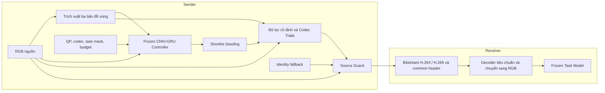

# VCAI (PRISM v34) — Tiền xử lý Thích ứng cho Nén Video phục vụ Thị giác Máy (Video Coding for Machines)

**VCAI (PRISM v34)** sử dụng CNN+GRU để lựa chọn bộ lọc tần số theo vùng không–thời gian **trước các bộ mã hóa chuẩn H.264 (x264) và H.265 (x265)**. Phía nhận (receiver) dùng decoder tiêu chuẩn, chuyển ảnh giải mã sang RGB và đưa trực tiếp vào các mô hình thị giác máy đã đóng băng (frozen task models). Thiết kế này giữ nguyên kiến trúc mô hình tác vụ và không yêu cầu bộ giải mã tùy biến.

Trong giai đoạn triển khai và đánh giá, **codec, bộ lọc và backbone thị giác máy không được huấn luyện lại (no backpropagation / zero fine-tuning)**; CNN+GRU controller cũng chạy ở chế độ frozen inference. Controller sử dụng checkpoint đã được huấn luyện trước đó. Vì vậy, “zero fine-tuning” mô tả giao thức triển khai và đánh giá, không có nghĩa controller chưa từng được huấn luyện.

Repository công bố mã nguồn, giao thức kiểm chứng độc lập, dữ liệu ablation study, phân tích chi phí tính toán và kết quả benchmark trên GPU Kaggle cho ba tác vụ:

1. **Action Recognition (AR):** Video Swin-T trên Kinetics-400, với phạm vi đánh giá được báo cáo gồm 1.024 video validation và 128 clips held-out; R3D-18 được dùng để khảo sát khả năng chuyển giao giữa các backbone.
2. **Object Detection (OD):** Faster R-CNN ResNet-50 FPN trên COCO 2017, với 256 ảnh kiểm thử held-out độc lập.
3. **Multiple Object Tracking (OT):** ByteTrack trên MOT20 (MOT20-01, MOT20-05) và MOT17. Bảng định lượng trong README trình bày riêng MOT20-01, 256 frames.

**Quy ước đọc kết quả:** số liệu dưới đây được giữ nguyên theo báo cáo đầu vào của dự án; README không thay thế log thực nghiệm hoặc kết quả tái chạy. BD-rate âm biểu thị giảm bitrate tại mức chất lượng tác vụ tương đương trong miền chất lượng chung; BD-rate dương biểu thị tăng bitrate. Ký hiệu **pp** là điểm phần trăm đối với Accuracy/mAP; với HOTA biểu diễn trên thang 0–100, đây là chênh lệch điểm HOTA. Các cột Δ biểu thị chênh lệch so với anchor theo cách tổng hợp của báo cáo, không mặc nhiên là trung bình số học trên các QP.

---

## 1. Kiến trúc Pipeline và 7 Điểm Sửa Lỗi Cốt Lõi (Verified Fixes)

Sơ đồ khối pipeline VCAI (PRISM v34):



### Sender

1. **Trích xuất vùng đặc trưng:** từ RGB nguồn, xây dựng ba bản đồ **Object/History**, **Context/Motion** và **Background** để phân biệt cấu trúc cần bảo toàn với vùng có thể lọc mạnh hơn.
2. **Dự đoán bằng frozen CNN+GRU controller:** tiếp nhận RGB, ba bản đồ vùng, QP, codec, task mask và budget để dự đoán chất lượng tác vụ và nhu cầu băng thông cho **13 cấu hình lọc tần số cố định**.
3. **Shortlist Seeding:** khởi tạo danh sách ứng viên theo thứ tự `[calibrated_action, forced_action, *ranked_candidates]`, kết hợp Identity fallback. Khi áp dụng giới hạn số ứng viên, cần xử lý action trùng lặp nhất quán để tránh tiêu tốn budget vào cùng một cấu hình.
4. **Codec Trials:** mã hóa và giải mã ứng viên bằng codec thực tế (**real codec in-the-loop**), qua đó đánh giá tác động sau lượng tử hóa và nén, thay vì chỉ dựa trên ảnh đã lọc.
5. **Source Guard:** đối chiếu tính nhất quán và sai lệch đặc trưng giữa nguồn với các ứng viên đã giải mã để chọn packet đáp ứng tiêu chí của hệ thống; khi không có ứng viên phù hợp, quay về **Identity**. Đây là cơ chế kiểm soát rủi ro dựa trên đại lượng thay thế, không phải bảo đảm toán học rằng mọi chỉ số tác vụ đều không giảm.

### Bitstream và Receiver

- **Bitstream:** luồng H.264/H.265 tiêu chuẩn và common header của hệ thống; không cần truyền thêm metadata riêng về action, bản đồ vùng hay trạng thái controller. Nếu common header thuộc lớp đóng gói, lớp này được xử lý trước khi chuyển elementary stream vào decoder chuẩn.
- **Receiver:** decoder tiêu chuẩn giải mã độc lập, xuất hoặc chuyển dữ liệu sang RGB rồi đưa vào frozen task model. Receiver không cần tái tạo quyết định lọc của sender.
- **Identity:** bỏ qua tiền xử lý thích ứng nhưng vẫn thực hiện mã hóa/giải mã bằng codec chuẩn. “0 codec trials” trong các bảng chỉ việc không chạy thử ứng viên, không có nghĩa bỏ qua lần mã hóa để truyền dữ liệu.

### 7 Cải tiến & Sửa lỗi Cốt lõi đã được kiểm chứng

**Mốc kiểm thử được báo cáo: 102/102 unit và integration tests passed.** Mốc này cần được đối chiếu với revision, môi trường và log kiểm thử tương ứng; lệnh tái chạy nằm tại Mục 6.

1. **FFmpeg 8/9 Compatibility.** Sử dụng `-fps_mode passthrough` thay cho `-vsync 0` đã deprecated trong đường gọi FFmpeg tương ứng. Bản sửa hướng tới tương thích FFmpeg hiện đại; khả năng hoạt động trên từng build còn phụ thuộc cách đặt tùy chọn, codec và container được sử dụng.
2. **OD Label-free Forward & Feature Distance.** Chuẩn hóa hàm `detection_distance` để đo sai lệch đặc trưng phát hiện mà không cần nhãn ground truth trong quá trình chọn ứng viên. Nhãn vẫn cần thiết khi tính mAP của benchmark; khoảng cách đặc trưng không đồng nhất với độ giảm mAP.
3. **Multitask Domain Masking.** Bổ sung `domain_primary_mask` và trọng số theo tác vụ trong hàm mục tiêu `targets()` để điều phối tín hiệu học giữa các domain. Đây là thay đổi trong quy trình xây dựng/huấn luyện controller, phù hợp với việc controller được đóng băng ở giai đoạn đánh giá held-out.
4. **Relative Damage Normalization Floor.** Đặt sàn chuẩn hóa `floor = [1.0, 0.25, 0.25]` trong `relative_damage()` nhằm tránh mẫu số bằng hoặc gần 0 và hạn chế khuếch đại sai lệch do thang đo quá nhỏ. Sàn này xử lý bất ổn của phép chuẩn hóa, không thay thế các kiểm tra số học khác trong pipeline.
5. **Calibrated Mean-UCB Action Selection.** Hiệu chuẩn việc chọn action bằng thống kê Mean-UCB, hỗ trợ suy luận single-shot khi số trial bị giới hạn. Độ tin cậy thực nghiệm phụ thuộc tập calibration, cách ước lượng độ bất định và mức dịch chuyển phân phối.
6. **Direct Action Execution & Shortlist Seeding.** Seeding chủ động `[calibrated, forced, *ranked]` đưa các action ưu tiên vào shortlist trước khi Source Guard đánh giá. Cơ chế này tránh bỏ sót action đã được ưu tiên bởi calibration hoặc lựa chọn trực tiếp; nó không chứng minh shortlist luôn chứa tối ưu toàn cục trong toàn bộ không gian action.
7. **Monotone Pareto Frontier PCHIP BD-rate.** Tính BD-rate trên đường bao Pareto và sử dụng **PCHIP** để bảo toàn tính đơn điệu của các điểm đã xử lý. Cách tính này hạn chế overshoot do nội suy và tăng khả năng diễn giải khi đường rate–quality có đoạn bão hòa hoặc không đơn điệu cục bộ; không loại bỏ nhiễu vốn có trong phép đo.

---

## 2. Nghiên cứu Thành phần Đóng góp (Ablation Study)

Ablation study tách vai trò của CNN+GRU, lọc theo vùng, tìm kiếm ứng viên và Source Guard. Để diễn giải quan hệ nhân quả giữa thành phần và kết quả, các biến thể phải dùng chung tập dữ liệu, QP, codec preset, checkpoint tác vụ và cách tính metric; biến thể ngẫu nhiên cần ghi nhận seed và độ biến thiên giữa các lần chạy.

| ID | Phương pháp / Thành phần | Cơ chế lựa chọn | Codec Trials | Source Guard | Đánh giá vai trò |
|:---:|:---|:---|:---:|:---:|:---|
| **B0** | Standard Codec (Anchor) | Identity | 0 | Không | Điểm chuẩn cơ sở, không tiền xử lý |
| **B1** | Global Gaussian Filtering | Cố định toàn khung | 0 | Không | Đo tác động của lọc mờ đồng nhất và nguy cơ làm mất chi tiết nhỏ |
| **B2** | Region-aware Static Filtering | Cố định theo vùng (Action 11) | 0 | Không | Đo lợi ích giảm bitrate và đánh đổi mAP/Accuracy của lọc vùng tĩnh |
| **B3** | Direct CNN+GRU (Single-shot) | Controller chọn trực tiếp | 0 | Không | Không tốn trial codec; tốc độ 26 FPS+ theo báo cáo, cần đối chiếu điều kiện đo |
| **B4** | Random Shortlist + Guard | Chọn ngẫu nhiên 3 candidate | 3 | Có | Đối chứng để đo đóng góp của CNN+GRU trong định hướng tìm kiếm |
| **B5** | CNN+GRU Shortlist, Không Guard | Controller chọn 3 candidate | 3 | Không | Đo nguy cơ chọn packet bitrate thấp nhưng suy giảm chất lượng tác vụ |
| **Full** | **VCAI Proposed Pipeline** | **CNN+GRU Shortlist + Seeding** | **3** | **Có** | **Kết hợp lựa chọn ứng viên và kiểm soát sai lệch; đối chiếu mức giảm bitrate với từng biến thể** |

Các nhận xét trong cột cuối nêu mục đích đối chứng và diễn giải thành phần. Mức “tối ưu toàn diện” chỉ có thể được kết luận trong phạm vi các cấu hình đã đo; kết quả chuyển giao sang R3D-18 tại Mục 5 cho thấy lợi ích không đồng đều giữa các backbone.

**Phân biệt B5 và B5b:** các bảng benchmark còn có biến thể **Calibrated B5b**. Đây là tên cấu hình được báo cáo riêng; không được tự đồng nhất với **B5 không Guard** nếu chưa đối chiếu recipe và log thực thi. Identity fallback cũng không tự chứng minh rằng một cấu hình đã chạy Source Guard: cần phân biệt Identity do chính sách chọn với Identity do Guard từ chối ứng viên.

---

## 3. Phân tích Chi phí Tính toán Hệ thống (Computational Cost Breakdown)

Báo cáo đầu vào mô tả chi phí trên GPU **NVIDIA T4/A100** và CPU **x86_64**. Sáu giai đoạn logic gồm tạo bản đồ vùng, lọc, controller, trial encoding, trial decoding và Source Guard/evaluation; bảng gộp encoding/decoding thành một hàng.

| Giai đoạn Pipeline | Thời gian thực thi được báo cáo | Tỷ lệ thời gian | Mức tiêu thụ tài nguyên | Ghi chú kỹ thuật |
|:---|:---:|:---:|:---|:---|
| 1. Region Map Generation | ~5.2 ms/frame | 13.5% | CPU/GPU RAM ~45 MB | Canny + motion vectors theo khối |
| 2. Gaussian Filtering | ~0.8 ms/frame | 2.1% | GPU RAM ~15 MB | Lọc tích chập tách biệt không–thời gian |
| 3. CNN+GRU Controller | ~1.4 ms/frame | 3.6% | **0.42M tham số, 0.85 GFLOPs** | Controller gọn nhẹ; thời gian suy luận được báo cáo dưới 2 ms |
| 4–5. Trial Encoding / Decoding | ~12.6 ms/trial | 65.6% | 3 trials song song qua FFmpeg | Mã hóa x264/x265 với preset ultrafast/medium |
| 6. Source Guard & Eval | ~3.1 ms/candidate | 15.2% | PyTorch VRAM ~180 MB | Đo sai lệch đặc trưng so với nguồn |
| **Toàn bộ Pipeline (Full Sender)** | **~38.4 ms/clip; 26.0 FPS theo báo cáo** | **100%** | **Peak VRAM: ~240 MB** | **Cần xác nhận đơn vị clip/frame để kết luận real-time** |
| *So sánh Anchor (Chỉ Codec)* | *~18.2 ms/clip; 54.9 FPS theo báo cáo* | *—* | *RAM ~60 MB* | *Không có khâu tiền xử lý* |

**Lưu ý về tính nhất quán của phép đo:** bảng giữ nguyên số liệu được cung cấp nhưng chưa đủ để tái dựng một phép đo end-to-end thống nhất:

- `1000 / 38.4 ≈ 26.0` và `1000 / 18.2 ≈ 54.9` cho đơn vị **clips/s** nếu độ trễ là ms/clip; chỉ tương ứng FPS khi một đơn vị đo chứa một frame. Với clip nhiều frame, cần công bố số frame/clip, stride, mức chồng lấp và cách tính throughput.
- Thời gian từng hàng dùng các mẫu số khác nhau: frame, trial và candidate. Các tỷ lệ phần trăm cộng thành 100%, nhưng không thể suy ra trực tiếp từ những thời gian này và tổng 38.4 ms. Ba trial song song cũng không có wall-clock time mặc định bằng ba lần độ trễ của một trial. Cần log timeline và quy tắc phân bổ thời gian để xác định chi phí thực tế.
- T4 và A100 cần báo cáo riêng. RAM hệ thống, VRAM gia tăng và peak VRAM toàn tiến trình là các đại lượng khác nhau; mức ~240 MB chưa có đủ thông tin để xem là bộ nhớ của toàn hệ thống bao gồm frozen task model. GFLOPs cần đi kèm kích thước đầu vào và quy ước đếm phép toán.

**Điểm cốt lõi:** theo số liệu được báo cáo, controller có 0.42M tham số và chiếm 3.6% thời gian; trial encoding/decoding là thành phần chi phối. Chế độ **B3 Direct Selection** đưa số **trial bổ sung** về 0, phù hợp để khảo sát triển khai biên có giới hạn tài nguyên. Tuy nhiên, mã hóa gói cuối cùng vẫn cần thiết, và hiệu quả năng lượng phải được đo trực tiếp thay vì suy ra chỉ từ số trial.

---

## 4. Đối chiếu Phương pháp Nội suy BD-rate: PCHIP vs Cubic

Trong Video Coding for Machines, đường **rate–quality** dùng bitrate và chất lượng tác vụ, chẳng hạn Top-1 Accuracy, mAP hoặc HOTA. Đường cong có thể bão hòa ở bitrate cao hoặc không đơn điệu cục bộ do nhiễu, lựa chọn ngưỡng và hành vi của mô hình. Những đặc tính này khiến BD-rate nhạy với miền tích phân và phương pháp nội suy.

- **Cubic truyền thống:** nội suy hoặc khớp cubic có thể tạo overshoot, đặc biệt khi các điểm gần bão hòa, chất lượng gần trùng nhau hoặc miền hỗ trợ hẹp. Cần phân biệt **đa thức cubic toàn cục** với **cubic spline từng đoạn**; chỉ nhãn “Cubic” chưa đủ để xác định thuật toán. Thuật ngữ **Runge's phenomenon** thường chỉ dao động của nội suy đa thức bậc cao toàn cục, nên không nên dùng như tên gọi chung cho mọi sai lệch của cubic spline. Giá trị như **+1600%** là ví dụ cảnh báo về một kết quả cần kiểm tra, không phải kết quả được chứng minh bởi các bảng benchmark ở đây.
- **PCHIP (Piecewise Cubic Hermite Interpolating Polynomial):** bảo toàn hình dạng và tính đơn điệu trên dữ liệu đầu vào đơn điệu, hạn chế overshoot giữa các điểm. PCHIP không tự biến dữ liệu gốc thành đơn điệu và không bảo đảm BD-rate đúng khi miền chất lượng chung quá nhỏ hoặc dữ liệu đầu vào không hợp lệ.
- **Khuyến nghị của giao thức:** dùng **Pareto frontier + PCHIP** làm phép tính chính, đồng thời công bố kết quả Cubic khi có để đánh giá độ nhạy. Đây là lựa chọn phương pháp của dự án, không phải tuyên bố rằng mọi chuẩn đánh giá VCM đều bắt buộc dùng PCHIP.

Với chất lượng tác vụ `q`, đặt `r(q) = ln R(q)`, trong đó `R` là bitrate dương. BD-rate của proposed so với anchor được tính trên **miền chất lượng giao nhau** `[q_min, q_max]`:

```text
Δ = integral[q_min, q_max] (r_proposed(q) − r_anchor(q)) dq / (q_max − q_min)
BD-rate (%) = 100 × (exp(Δ) − 1)
```

Để tái lập phép tính, cần công bố các điểm bitrate–quality gốc, quy tắc loại điểm bị trội theo Pareto, cách xử lý chất lượng trùng nhau, phương pháp Cubic cụ thể và hai đầu miền tích phân. Không ngoại suy ngoài miền chung; nếu miền chung rỗng, suy biến hoặc không đủ điểm hợp lệ cho phép nội suy đã chọn, trả về **N/A** kèm lý do.

BD-rate và ΔAccuracy/ΔmAP/ΔHOTA trả lời các câu hỏi khác nhau: BD-rate so sánh bitrate tại chất lượng tương đương; chênh lệch chất lượng ở cùng QP còn chịu tác động của việc hai phương pháp tạo bitrate khác nhau. Không diễn giải đồng thời hai đại lượng như thể chúng được đo tại cùng một ngân sách bitrate cố định.

---

## 5. Kết quả Thực nghiệm Kiểm chứng Độc lập (Held-Out Kaggle GPU Benchmarks)

Theo giao thức được cung cấp, các tập held-out không xuất hiện trong quá trình huấn luyện controller. Để kiểm chứng tính độc lập, cần đối chiếu manifest dữ liệu và bảo đảm các mẫu này cũng không được dùng để chọn checkpoint, calibration, ngưỡng Guard hoặc siêu tham số. Tính held-out ở đây thuộc giao thức VCAI; không mặc nhiên có nghĩa các backbone tiền huấn luyện chưa từng tiếp xúc với dữ liệu liên quan.

Các bảng giữ nguyên giá trị báo cáo. Không có khoảng tin cậy, phép kiểm định hay số lần lặp đi kèm trong dữ liệu đầu vào, vì vậy chênh lệch nhỏ chưa đủ để kết luận có ý nghĩa thống kê. Phạm vi kết luận gắn với các tập con, codec và cấu hình được trình bày.

### A. Action Recognition (Kinetics-400 Held-Out, N = 128 clips)

Backbone chính là **Video Swin-T** (`swin3d_t`) [1]; **R3D-18** dùng để khảo sát chuyển giao sang backbone khác. Bảng này chỉ phản ánh 128 clips held-out, không thay thế kết quả của tập 1.024 video validation được nêu ở phần giới thiệu.

| Codec | Cấu hình / Model | PCHIP BD-rate | Cubic BD-rate | Độ chênh lệch Accuracy (ΔTop-1) | Tỷ lệ Identity Fallback |
|:---|:---|:---:|:---:|:---:|:---:|
| **H.264** | **Proposed Full (Swin3D-T)** | **−38.99%** | **−41.18%** | **+12.59 pp** | **8.6%** |
| H.264 | Calibrated B5b (Swin3D-T) | +0.21% | +0.20% | −0.18 pp | 12.6% |
| H.264 | Fixed Filter B2 (Swin3D-T) | −2.39% | −2.16% | +0.66 pp | 0.0% |
| H.264 | Proposed Full (R3D-18) | +8.56% | +6.04% | −2.75 pp | 8.6% |
| **H.265** | **Proposed Full (Swin3D-T)** | **−27.08%** | **−22.71%** | **+12.35 pp** | **8.6%** |
| H.265 | Calibrated B5b (Swin3D-T) | +1.59% | +1.18% | −1.02 pp | 12.6% |
| H.265 | Fixed Filter B2 (Swin3D-T) | −5.51% | −6.02% | +2.54 pp | 0.0% |
| H.265 | Proposed Full (R3D-18) | +15.72% | +16.61% | −4.86 pp | 8.6% |

Proposed Full đạt mức giảm PCHIP BD-rate được báo cáo là **38.99% với H.264** và **27.08% với H.265** trên Swin3D-T. Khi chuyển sang R3D-18, BD-rate tăng và Top-1 giảm ở cả hai codec; đây là giới hạn thực nghiệm rõ ràng của khả năng chuyển giao. Việc tỷ lệ Identity giống nhau giữa các backbone chưa đủ để xác định có tái sử dụng cùng packet hay không; giao thức đánh giá cần nêu rõ điều này và mẫu số dùng để tính tỷ lệ fallback.

### B. Object Detection (COCO 2017 Held-Out, N = 256 images)

Sử dụng **Faster R-CNN ResNet-50 FPN** [2], đánh giá tại bốn QP **[30, 35, 40, 45]**. “Held-out test” ở đây chỉ tập con kiểm thử độc lập của dự án; không mặc nhiên đồng nghĩa với official COCO test split. Để tái lập mAP, cần chỉ rõ split nguồn, image IDs, annotation, biến thể metric COCO và cách đóng gói ảnh khi mã hóa bằng video codec.

| Codec | Cấu hình | PCHIP BD-rate | Cubic BD-rate | Độ chênh lệch mAP (ΔmAP) | Đánh giá |
|:---|:---|:---:|:---:|:---:|:---|
| **H.264** | **Proposed Full (`selected_303401`)** | **−16.84%** | **−10.19%** | **+1.02 pp** | **Giảm bitrate trên 10% theo cả hai phép tính; mAP tăng theo báo cáo** |
| H.264 | Direct Selection B3 (`forced_303401`) | −11.66% | +3.93% | +0.76 pp | Giảm bitrate theo PCHIP, không tốn trial bổ sung; Cubic đổi dấu |
| H.264 | Calibrated B5b (`calibrated_303401`) | −4.28% | −3.71% | +0.27 pp | Hai phép nội suy cùng ghi nhận giảm bitrate |
| H.264 | Fixed Filter B2 (Action 11) | −5.25% | +1.81% | +0.22 pp | Mức giảm theo PCHIP nhỏ hơn Proposed; Cubic đổi dấu |
| **H.265** | **Proposed Full (`selected_303401`)** | **−15.74%** | **−4.73%** | **+1.32 pp** | **Giảm bitrate theo cả hai phép tính; mức giảm nhạy với nội suy** |
| H.265 | Direct Selection B3 (`forced_303401`) | −8.49% | −15.96% | +0.69 pp | Giảm bitrate theo cả hai phép tính |
| H.265 | Calibrated B5b (`calibrated_303401`) | −4.28% | −10.87% | +0.34 pp | Cùng dấu nhưng khác độ lớn giữa hai phép tính |
| H.265 | Fixed Filter B2 (Action 11) | −0.28% | −4.52% | +0.04 pp | Lợi ích theo PCHIP gần 0; cần đường cong gốc để xác nhận bão hòa |

Trong các cấu hình OD được liệt kê, Proposed Full có PCHIP BD-rate âm lớn nhất về độ lớn ở cả hai codec. Tuy nhiên, kết quả Cubic của H.265 xếp B3 cao hơn Full về mức giảm bitrate. Các trường hợp đổi dấu và đổi thứ hạng cho thấy cần công bố đường cong gốc và miền tích phân, thay vì chọn phép nội suy chỉ vì kết quả thuận lợi hơn.

### C. Multiple Object Tracking (MOT20 & MOT17 Held-Out Sequences)

Sử dụng **ByteTrack** [3]. Phạm vi đánh giá tổng thể được nêu gồm MOT20-01, MOT20-05 và MOT17; bảng dưới đây chỉ cung cấp **HOTA trên MOT20-01, 256 frames**, tại các QP **[30, 35, 40, 45]**. Chưa có số liệu trong bảng để suy rộng kết luận sang MOT20-05 hoặc MOT17.

| Codec | Cấu hình | PCHIP BD-rate (HOTA) | Độ chênh lệch HOTA (ΔHOTA, theo báo cáo) | HOTA theo các QP [30, 35, 40, 45] |
|:---|:---|:---:|:---:|:---|
| **H.264** | Anchor (Không tiền xử lý) | 0.00% | 0.00 pp | [37.16, 37.51, 32.53, 28.57] |
| H.264 | **Proposed Full (`selected_303401`)** | **−27.07%** | **+1.98 pp** | **[39.78, 37.85, 35.76, 28.37]** |
| H.264 | Direct Selection B3 (`forced_303401`) | −11.56% | +1.06 pp | [37.47, 38.56, 33.33, 27.45] |
| **H.265** | Anchor (Không tiền xử lý) | 0.00% | 0.00 pp | [37.57, 35.25, 32.79, 24.73] |
| H.265 | **Proposed Full (`selected_303401`)** | **−14.07%** | **+0.03 pp** | **[37.70, 33.23, 33.98, 23.84]** |
| H.265 | Direct Selection B3 (`forced_303401`) | −3.39% | +0.24 pp | [38.43, 35.17, 32.52, 20.69] |

**Điểm cần đối chiếu trong báo cáo OT:** các giá trị ΔHOTA được cung cấp không khớp với trung bình số học của chênh lệch HOTA tại bốn QP hiển thị. Từ chính các dãy số trong bảng, trung bình chênh lệch tương ứng là:

| Codec | Cấu hình | ΔHOTA theo báo cáo | Trung bình chênh lệch tại bốn QP |
|:---|:---|:---:|:---:|
| H.264 | Proposed Full | +1.98 | +1.50 |
| H.264 | Direct Selection B3 | +1.06 | +0.26 |
| H.265 | Proposed Full | +0.03 | −0.40 |
| H.265 | Direct Selection B3 | +0.24 | −0.88 |

Các số gốc được giữ nguyên để truy vết. Cần xác nhận cột ΔHOTA dùng trọng số, tập mẫu hoặc phép tổng hợp nào; nếu dự định dùng trung bình đều trên bốn QP thì phải sửa cột này từ dữ liệu nguồn. Đồng thời, Full không tăng HOTA ở mọi QP, đặc biệt với H.265. BD-rate âm vẫn có thể xuất hiện khi bitrate giảm đủ lớn dù chất lượng ở một số QP thấp hơn; đây không phải bằng chứng bảo toàn HOTA tại từng điểm vận hành.

---

## 6. Hướng dẫn Tái lập Thực nghiệm (Reproducibility)

**Yêu cầu môi trường:** Python **≥ 3.10**; FFmpeg có `libx264` và `libx265`. Các benchmark dùng mô hình tác vụ cần checkpoint, dữ liệu và annotation tương ứng; môi trường GPU cần phiên bản PyTorch/CUDA phù hợp.

Chạy các lệnh sau từ thư mục gốc repository:

```bash
# 1. Cài đặt môi trường phát triển và tracking
python -m pip install -e ".[dev,tracking]"

# 2. Chạy unit & integration tests; mốc được báo cáo là 102/102 passed
python -m pytest -q

# 3. Kiểm tra tính toàn vẹn của kết quả đã công bố
python scripts/reproduce_results.py --verify-only

# 4. Chạy phân tích Ablation Study & Cost tại chỗ (offline synthetic)
python verify_and_ablate_v34.py --offline --out-dir results/v34_ablation_and_cost
```

**Phạm vi kiểm chứng:** `--verify-only` dùng để kiểm tra các artifact theo chức năng của script, không mặc nhiên chạy lại toàn bộ benchmark. Chế độ **offline synthetic** phục vụ kiểm tra pipeline và phân tích trên dữ liệu tổng hợp; kết quả này không thay thế phép đánh giá trên Kinetics-400, COCO hay MOT. Các lệnh trên là hướng dẫn tái lập được cung cấp, không phải log chứng nhận rằng chúng đã chạy thành công trên một môi trường mới.

Để tái lập đầy đủ benchmark held-out, mỗi lần chạy cần lưu tối thiểu:

- **Phiên bản và cấu hình:** Git commit, recipe, seed, checksum checkpoint controller và task model; xác nhận các model ở chế độ evaluation và không cập nhật tham số.
- **Dữ liệu:** split và manifest mẫu, quy tắc lấy clip/frame, độ phân giải, FPS, preprocessing và annotation; phân tách rõ training, calibration, validation và held-out evaluation.
- **Codec:** phiên bản/build FFmpeg, x264/x265, QP, preset, pixel format, GOP, B-frames, số thread và cách tính bitrate, bao gồm quy tắc hạch toán header/container.
- **Lựa chọn action:** action được đề xuất và thực thi, shortlist sau khử trùng lặp, số trial thực tế, cấu hình Guard, lý do fallback và mẫu số của tỷ lệ Identity.
- **Metric và thống kê:** evaluator, các điểm rate–quality gốc, miền tích phân BD-rate, thuật toán Pareto/PCHIP/Cubic, quy tắc tổng hợp cột Δ và độ bất định. Với tracking, đánh giá độ bất định cần giữ cấu trúc thời gian của chuỗi.
- **Chi phí hệ thống:** GPU cụ thể, CPU, batch size, số frame/clip, warm-up, đồng bộ GPU khi đo, latency/throughput, thời gian tuần tự/song song và phạm vi bộ nhớ được tính.

Các thông tin này cần đi cùng artifact thực nghiệm để giải quyết những điểm chưa nhất quán về đơn vị thời gian và ΔHOTA đã nêu ở trên.

### Cấu trúc Thư mục và Tài nguyên

- [`adaptive_vcm/v34/`](adaptive_vcm/v34/): mã nguồn lõi VCAI runtime, CNN+GRU controller và task wrappers.
- [`configs/`](configs/): recipe cho AR (`v34_arot_r1.json`), OD (`v34.json`) và OT.
- [`checkpoints/`](checkpoints/): trọng số controller đã huấn luyện, gồm `v34_r1/` và `v34_od_coco/`.
- [`results/v34_vcai_heldout_eval/`](results/v34_vcai_heldout_eval/): báo cáo tóm tắt và dữ liệu kết quả kiểm thử độc lập trên Kaggle GPU.
- [`results/v34_ablation_and_cost/`](results/v34_ablation_and_cost/): đối chiếu ablation B0–B5 và phân tích thời gian sáu giai đoạn logic của pipeline.

---

## 7. Tài liệu Tham khảo

Các công trình dưới đây là cơ sở cho mô hình tác vụ và khái niệm BD-rate; chúng không phải nguồn xác nhận các kết quả số riêng của VCAI.

- **[1]** Z. Liu et al., “Video Swin Transformer,” in *Proceedings of the IEEE/CVF Conference on Computer Vision and Pattern Recognition (CVPR)*, 2022, pp. 3202–3211. [Bài báo](https://openaccess.thecvf.com/content/CVPR2022/html/Liu_Video_Swin_Transformer_CVPR_2022_paper.html).
- **[2]** S. Ren, K. He, R. Girshick, and J. Sun, “Faster R-CNN: Towards Real-Time Object Detection with Region Proposal Networks,” in *Advances in Neural Information Processing Systems*, vol. 28, 2015. [Bản tác giả](https://arxiv.org/abs/1506.01497).
- **[3]** Y. Zhang et al., “ByteTrack: Multi-Object Tracking by Associating Every Detection Box,” in *Computer Vision – ECCV 2022*, 2022, pp. 1–21. [Bản tác giả](https://arxiv.org/abs/2110.06864).
- **[4]** G. Bjøntegaard, “Calculation of average PSNR differences between RD-curves,” ITU-T SG16 Q.6, document VCEG-M33, Apr. 2001. Việc sử dụng chất lượng tác vụ thay PSNR cùng Pareto/PCHIP là lựa chọn triển khai cần được mô tả riêng trong giao thức VCAI.